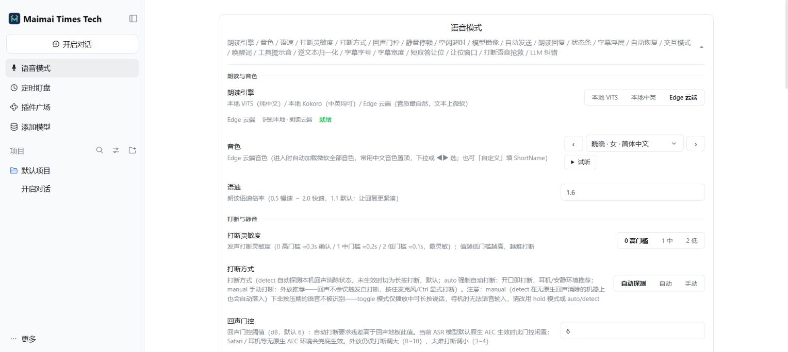

# 语音模式定制版 · dsh-voice-mode-custom

基于 [qishuilalala/dsh-voice-mode v0.7.38](https://github.com/qishuilalala/dsh-voice-mode/tree/v0.7.38) 的社区定制版，由 wuhe888 维护。保留原作者的语音识别、朗读、字幕和打断功能，增加独立侧栏设置页面与响应式布局。此项目不是 DeepSeek 官方插件，也不是原作者发布的版本。

上游基线：`c8eed54d46823d22ce62e070c71ac551b0e6a17a`。本版：`0.7.38-custom.2`。原始 MIT 许可证、版权声明和第三方许可均保留。

## 定制内容

- 侧栏“语音模式”使用线框麦克风图标，直接打开主面板设置页；页面顶部标题加粗，原来的设置弹窗入口继续可用。
- 两个入口共用设置，修改立即同步，折叠面板使用各自独立的无障碍标识。
- 主页面内容居中，最大宽度 960px；长页面可滚动，窄面板中名称与控件上下排列。
- 语音状态条跟随宿主输入框的宽度变量；宿主未提供变量时使用明确的布局回退值。
- 本地语音子进程在 Windows 隐藏控制台；位于 Electron ASAR 内的 worker 指向对应的 `asar.unpacked` 文件。

数字分句和本地数字预处理完全保留上游 0.7.38。本版没有加入旧项目的小数补丁。上游已修复流式小数/版本号拆句，但 `src/tts-vits-worker.ts` 的本地数字预处理仍会把数字后的点转换为停顿；不要将分句修复理解为所有引擎的数字发音均已验收。



## 安装

需要已安装的 DeepSeek Harness。先关闭同一个 profile 中的原版 `dsh-voice-mode`，再安装定制版：二者共享 `voice-mode` 插件标识、HTTP 路由和设置文件，不能同时启用。桌面应用预装的原版需要通过该应用支持的插件管理方式关闭；本插件不会自行改写桌面应用。

```sh
dsh plugin --profile web add github:wuhe888/dsh-voice-mode-custom#v0.7.38-custom.2
```

安装后重启 DSH。也可以从 GitHub Releases 下载 `.tgz`，执行：

```sh
dsh plugin --profile web add ./dsh-voice-mode-custom-0.7.38-custom.2.tgz
```

本项目首先通过 GitHub 分发，未发布到 npm；仅输入 `dsh-voice-mode-custom` 不是这里提供的安装方式。主侧栏入口需要宿主支持 `main` 与 `sidebar.panellist` 槽位，旧宿主可继续使用原有设置弹窗。上游声明的版本范围不代表本定制版逐版本验收。

配置继续存储在 `$DSH_HOME/voice-mode.settings.json`，替换原版时可沿用已有设置。首次使用可能需要下载识别或本地朗读模型。默认 Edge 引擎会将朗读文本发送到微软语音服务；VITS/Kokoro 在本机合成。

原有入口位于设置（Settings）→ 语音模式（Voice mode）。设置生效时机分四档：立即生效、下一次识别、下一段话、下一次进入语音模式；各字段的具体时机以面板说明为准。尚未生效的选项会在设置卡片上显示当前生效值。

## 桌面兼容的责任范围

| 项目 | 本版处理 |
| --- | --- |
| 桌面端默认内置 | 由桌面应用的依赖和 profile 决定，不属于可独立安装插件的功能。 |
| Windows 子进程窗口 | 保留 `windowsHide: true`。 |
| ASAR 中的语音文件 | 保留路径处理；打包应用还必须实际解包插件及 sherpa 依赖，否则仅改路径不够。 |
| Kokoro 使用普通 Node | 保留上游 Electron 检测和 `DSHVM_NODE` / PATH 查找。应用内置 Node 的位置由宿主提供，本插件不猜测其他应用的目录。 |
| sherpa 原生模块提升布局 | 旧项目的依赖补丁属于该桌面安装包的布局适配，没有修改用户的 `node_modules`；定制桌面发行方需单独验证原生模块。 |

## 从这里开始开发

1. 安装 Git、Node.js 24 和 pnpm 11，克隆自己的仓库。

   ```sh
   git clone https://github.com/wuhe888/dsh-voice-mode-custom.git
   cd dsh-voice-mode-custom/plugin/dsh-voice-mode
   pnpm install --frozen-lockfile
   ```

2. 修改源码。独立设置页面在 `src/custom-settings-page.tsx`；设置控件在 `src/settings-form.tsx`；侧栏注册和状态条在 `src/client.tsx`。不要直接编辑生成的 `lib/`。

3. 构建并检查。

   ```sh
   pnpm build
   pnpm typecheck
   pnpm test:custom
   ```

4. 使用单独的测试 profile 安装本地插件，在真实 DSH 页面检查入口、保存、语言切换和窄窗口。修改源码后重新构建并刷新页面。
5. 发布新版本时同时更新仓库根和插件目录的 `package.json` 版本，以及 `CUSTOM_CHANGELOG.md`。把源码和构建后的 `lib/` 一起提交，再推送对应 `v版本号` 标签。Release 工作流运行检查并上传安装包，不会发布 npm。

上游完整使用说明保存在仓库根 `README.upstream.md` 以及插件目录 `README.upstream.md` / `README.upstream.en.md` 中；其中的上游安装命令与发布信息仅供参考。

## 验证范围

本次本地验证使用 Windows、Node.js 24.22.2 和定制 DSH 0.2.2-alpha.2：完成构建、Host/Client TypeScript 检查、针对性自动化测试、实际 profile 安装与页面加载、双入口设置同步、中文切换及 390px 窄屏布局。没有进行真实麦克风录音、模型对话、语音听感或完整 Electron 安装包验收。

`pnpm test:custom` 是本版可跨平台执行的针对性检查。上游 `pnpm test` 的第一个脚本需要 Bash；本机首次执行在缺少 Bash 的环境中失败，该结果不计为通过。
